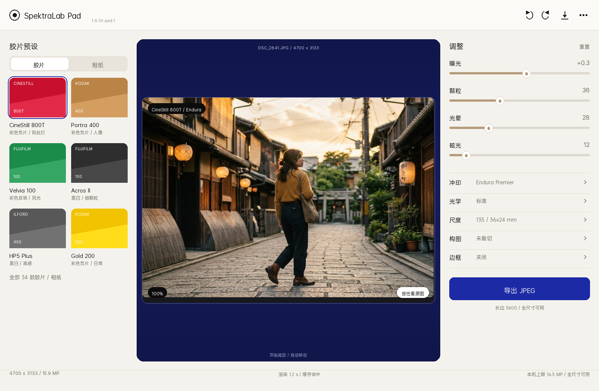
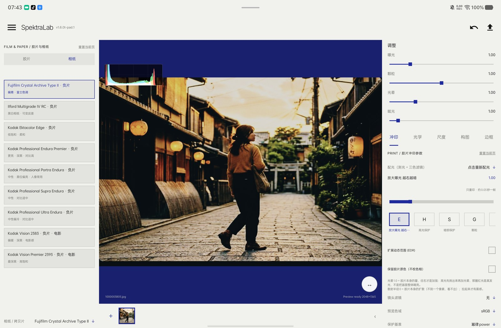

# SpektraLab Pad

给 [SpektraLab](https://github.com/JamesQiu2005/SpektraLab) 的 Android 版做**平板界面**的社区分支。

原版 Android 移植是手机竖屏布局（底部六个页签、弹出面板）。这个分支把它重排成
**左选胶片 / 中看照片 / 右调参数**的三栏工作台，目标是 vivo Pad6 Pro 这类大屏平板。

> 这是个人自用的 UI 分支，不是上游官方版本。

## 现状（2026-11-11）

| 阶段 | 内容 | 状态 |
|---|---|---|
| P0 | 三栏骨架：左 252dp 胶片、中画布、右 304dp 参数；右栏可收起 | 完成 |
| P1 | 纸白全局顶栏（菜单/名称/版本/撤销/分享/导出） | 完成 |
| P1 | 右栏常驻滑杆：曝光 / 颗粒 / 光晕 / 眩光 | 完成 |
| P1 | 左栏「胶片 ｜ 相纸」分段，相纸改为 9 款常驻列表 | 完成 |
| P1 | 画布去掉蓝底，改浅灰；状态栏与顶栏同色 | 完成 |
| P2 | 底部状态栏、按住看原图、双击 100%、撤销 | 待做 |
| P3 | 空态 / 渲染中 / 错误 / 导出完成样式 | 待做 |
| P4 | 竖屏与 840–999dp 断点 | 待做 |

设计规格：`docs/PAD_UI_DESIGN.md`　设计稿与真机截图：`docs/design/`

| 横屏主界面 | 真机（相纸列表） |
|---|---|
|  |  |

## 构建方式（重要）

**本仓库不包含引擎源码的构建，也不分发引擎二进制。** 构建时，把官方发行版 APK 里的
`assets/` 与 `lib/arm64-v8a/*.so` 取出来，和本仓库的 Java/资源层重新打包：

```bash
export ANDROID_HOME=$HOME/Android/Sdk          # SDK Platform 36 / Build Tools 36
bash tools/extract-official-apk.sh /path/to/app.spektralab.apk
bash tools/build-pad-apk.sh                    # 产物：.pad-build/SpektraLab-pad.apk
```

产物包名 `app.spektralab.pad`，可与官方 `app.spektralab` **并存安装**；
Java 类包名仍为 `app.spektralab.engine`，所以官方 .so 的 JNI 能正常绑定。

### 为什么不是「从源码构建引擎」

上游 Android 仓库的 README 发布了一个 `patches/engine-android.patch`，对指定的
引擎提交 `445e314` 可以干净应用，但：

1. 补丁没有新增 `engine/src/pipeline/tiling.hpp`，而它改动的 5 个源文件都 include 它；
   该文件在公开上游、全部标签与分支中都不存在；
2. 官方 1.6.0t 的引擎库还导出了 12 个 C API（`spk_suspend_session`、`spk_trim_pool` 等）
   与一整套分带框架符号，公开补丁里没有，而本仓库的 JNI 正在调用它们。

也就是说，公开源码与发行版是不同步的，按 README 无法复现官方 APK。
所以在拿到维护者补齐的引擎源码之前，这个分支只改 Java/资源层，引擎用官方二进制。
细节记录在 `docs/PAD_UI_DESIGN.md` 第 13 节。

## 与上游同步

- `master` 分支保持上游原样（`aef4e49`，1.6.0t / 341），用于合并新版本；
- `pad-ui` 分支是本分支的 UI 改动；
- 上游发新版时：拉 `master` → 在 `pad-ui` 上 rebase/merge → 改动用
  `PAD-UI` 注释标出，集中在 `MainActivity.java` 的少数方法；
- 引擎二进制的版本号与 APK 版本对应关系需要在本地记录。

## 许可与合规

- 本仓库代码继承上游：**GPL-3.0-or-later**（见 `LICENSE`）；
- 胶片/相纸配置与 LUT：**CC BY-SA 4.0**（见 `LICENSE-SPEKTRAFILM.txt`）；
- 本仓库**不包含**任何 `.so`、`assets`、官方 APK 或签名材料；
  自建 APK 若对外分发，需要能提供对应引擎源码并遵守 GPL，请先解决上面的源码缺口；
- 名称与图标沿用上游，公开发布衍生版前请按上游 README 的要求换成自己的名称与图标。

## 致谢

引擎与胶片模型：[JamesQiu2005/SpektraLab](https://github.com/JamesQiu2005/SpektraLab)（GPL-3.0-or-later）  
胶片模型与实测数据：[andreavolpato/spektrafilm](https://github.com/andreavolpato/spektrafilm)（CC BY-SA 4.0）  
Android 移植：[SAINTTaiYi/SpektraLab-Android](https://github.com/SAINTTaiYi/SpektraLab-Android)
